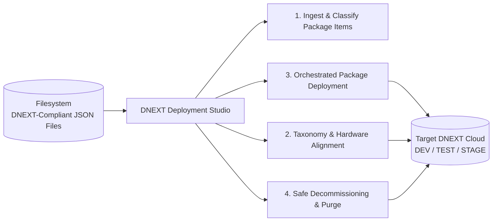
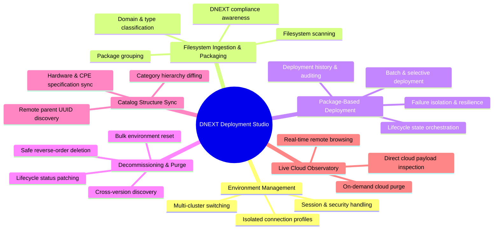

# High-Level Functional Design Document (FDD)
# Vodafone DNEXT Deployment Studio

---

## 📌 Document Overview

| Property | Description |
| :--- | :--- |
| **Product** | **Vodafone DNEXT Deployment Studio** |
| **Document Type** | High-Level Capability & Functional Scope Document |
| **Target Audience** | Product Managers, Solution Architects, Release Engineers, Developers |
| **Purpose** | Outline the high-level functional capabilities and business value of the studio—focusing on filesystem data ingestion, package-based deployment, lifecycle automation, and cloud synchronization without prescribing rigid technical implementation details. |

---

## 🎯 Executive Summary & Vision

The **Vodafone DNEXT Deployment Studio** is a unified visual command center and deployment platform designed to streamline how Vodafone teams manage, synchronize, and deploy DNEXT-compliant Product Catalog entities (TMF 620) across various DNEXT cloud environments.

**Deployment Studio does not author or generate catalog data.** Instead, it ingests pre-structured, DNEXT-compliant catalog data directly from the **filesystem**, organizes items into **cohesive release packages**, and orchestrates their end-to-end deployment, verification, and lifecycle management on target cloud environments.

---

## 🚀 Core Capability Map

---

## 🌟 Detailed Functional Capabilities

### 1. Multi-Target Cloud Environment Management
*Enables operators to switch between target cloud environments on the fly without system reboots or code reconfigurations.*

- **Dynamic Environment Selection**: Seamlessly switch active target clusters between DEV, TEST, STAGE, or custom partner environments.
- **Connection Profile Management**: Save, edit, and maintain authentication endpoints and base service gateways for each cloud cluster.
- **Secure Session Scoping**: Keep access tokens and credentials safely scoped to active user sessions and target environments with masked logging.

---

### 2. Filesystem Data Ingestion & Release Packaging
*Ingests DNEXT-compliant catalog data from the local filesystem and organizes it into deployable packages.*

- **Automated Filesystem Ingestion**: Automatically scan designated filesystem directories to detect and index all DNEXT-compliant payload definitions.
- **Release Package Organization**: Group catalog items into logical, deployable packages (e.g. baseline release packages, seasonal commercial bundles, proof-of-concept packages).
- **Entity & Domain Classification**: Automatically identify the entity role (*Product Offering, Product Offering Price, Bundled POP, Product Specification*) and business domain (*Fiber Connectivity, Hardware, TV, Regio Surcharge, SuperWLAN, Telephony/Voice, Promotions, Addons*).
- **Package Integrity & Inspect**: Inspect formatted payload structures directly within the studio before initiating deployment.

---

### 3. Package-Based Deployment & Lifecycle Orchestration
*Automates the deployment of complete catalog packages with multi-phase lifecycle progression required by DNEXT cloud gateways.*

- **Automated Lifecycle Sequencing**: Automatically handle mandatory cloud lifecycle state transitions (progressing items through initial draft/study stages into active, launched states with valid scheduling windows).
- **Package & Item-Level Deployment**: Deploy entire release packages as a cohesive unit or deploy selected individual items on demand.
- **Fault-Tolerant Execution**: Process deployment queues with failure isolation—an error on a single item does not abort the remainder of the package.
- **Real-Time Deployment Auditing**: Live execution progress tracking with detailed response logs, status codes, and itemized history.

---

### 4. Live Cloud State Awareness & Diff Detection
*Provides continuous visibility into the synchronization state between local filesystem data and target cloud environments.*

- **Remote Existence Verification**: Query target cloud environments to detect whether filesystem catalog items are already deployed, pending deployment, or in an error state.
- **Visual Status Matrix**: Clear status indicators across all package items for rapid operational assessment.
- **Out-of-Sync Detection**: Instantly identify drift between local package definitions and live cloud entities.

---

### 5. Resilient Entity Decommissioning & Purging
*Ensures clean, conflict-free removal of catalog entities across all existing versions on remote clouds.*

- **Cross-Version Discovery**: Automatically locate all existing historical and active version records of an entity on the target cloud.
- **Safe Lifecycle Decommissioning**: Transition active/launched items into obsolete status prior to deletion to satisfy cloud gateway lifecycle rules.
- **Dependency-Aware Deletion Order**: Delete multi-version entities in reverse dependency order to prevent referential integrity errors and zombie locks.
- **Bulk Cleanup & Environment Reset**: Clean entire test or deprecated catalog structures in bulk with consolidated execution summaries.

---

### 6. Category Hierarchy Synchronization
*Aligns product categories on target cloud environments with local filesystem taxonomy designs.*

- **Bi-Directional Category Diffing**: Compare local category definitions against remote cloud categories to identify missing nodes or structural discrepancies.
- **Remote Parent UUID Discovery**: Automatically discover and resolve parent category IDs on the remote cloud before publishing child subcategories.
- **Hierarchical Package Push**: Export categories with preserved multi-tier parent-child relationships.

---

### 7. Hardware & Device Specification Alignment
*Synchronizes telecom customer premises equipment (CPE), routers, ONTs, and accessories with cloud catalogs.*

- **Hardware Reference Alignment**: Read local hardware definitions and compare them against active cloud specifications.
- **Template-Based Specification Push**: Push device specifications with tailored characteristic overrides to target cloud catalogs.
- **Device Model Verification**: Verify that required hardware models (fiber modems, routers, repeaters, set-top boxes) exist on the cloud prior to launching dependent offerings.

---

### 8. Live Remote Catalog Explorer & Payload Auditor
*A real-time window into active cloud environments for validation, inspection, and troubleshooting.*

- **Direct Cloud Introspection**: Query and inspect active offerings, pricing models, specifications, and categories directly from the remote cloud.
- **Multi-Criteria Search & Filter**: Search entities by type, lifecycle status, commercial name, or unique identifier.
- **Live Raw Payload Inspector**: Inspect raw JSON responses returned by cloud APIs to verify live configuration attributes.
- **On-Demand Remote Purge**: Trigger immediate single-entity or batch purges directly from the live explorer view.

---

## 👥 User Personas & Value Delivered

| Persona | Primary Goal | Value Delivered by Studio |
| :--- | :--- | :--- |
| **Catalog Architect** | Organize and maintain telco catalog packages | Ingests filesystem definitions, validates taxonomy, and visualizes package readiness. |
| **Release / DevOps Engineer** | Deploy catalog packages across DEV, TEST, and STAGE | Executes package-based deployments, manages environment switching, and automates lifecycle state progression. |
| **QA / Test Automation** | Maintain clean test environment baselines | Purges obsolete versions and executes repeatable package deployments with zero residual zombie records. |
| **Product Manager** | Verify active catalog offerings on target environments | Explores live cloud state directly to confirm published tariffs, prices, and device associations. |

---

## 🔮 Key Qualities & Experience Principles

- **Filesystem-Driven Simplicity**: Directly reads and respects local DNEXT-compliant files without requiring external authoring databases.
- **Package-Centric Operations**: Treats catalog items as cohesive, deployable release units.
- **Zero-Friction Portability**: Operates standalone with zero external database dependencies.
- **Safety & Auditability**: Safe multi-version purging, non-blocking background deployment, and itemized execution auditing.
