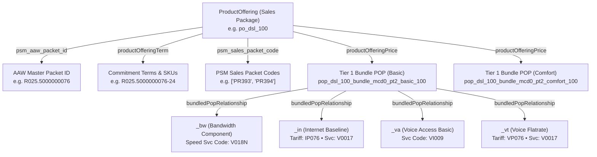
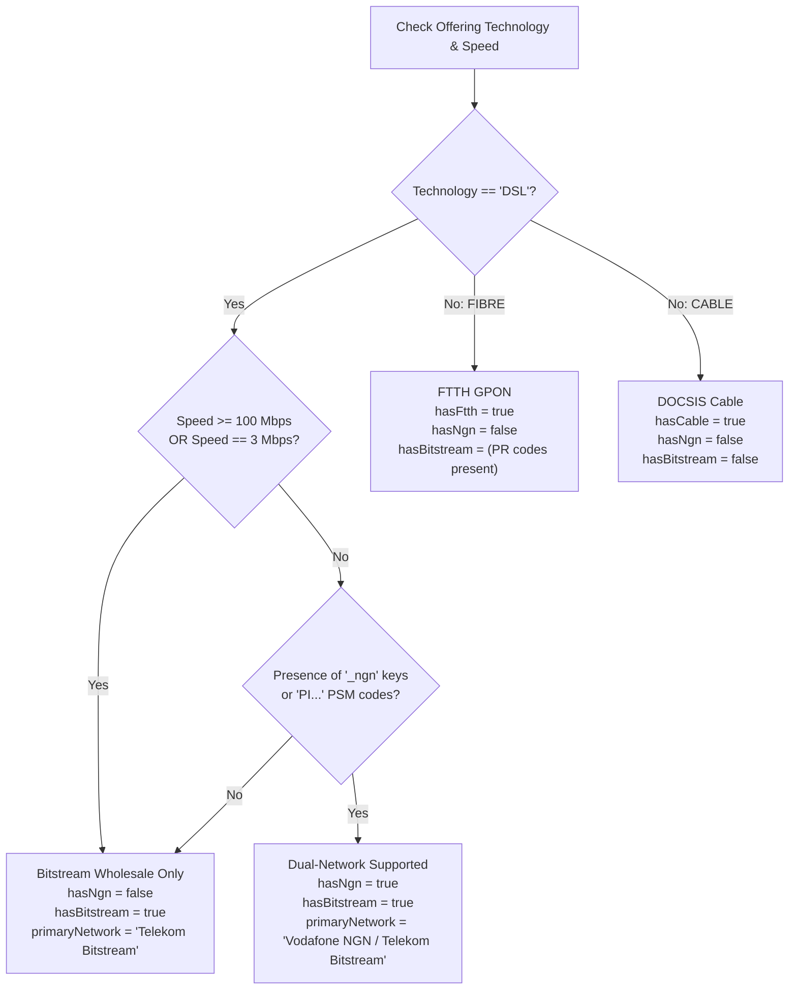

# CCB & PSM Data Extraction Guide

This document describes the architecture, rules, and step-by-step pipeline for extracting, normalizing, and synchronizing **PSM (Product / Sales / Provisioning Model) structure data**, **CCB Master Packets**, **contract commitment SKUs**, and **network-specific billing codes** from the catalog.

---

## 1. Overview & Business Context

In the Vodafone Fixed-Net (FN) Catalog and CCB/AAW order management systems:
- Every **Sales Package** (`ProductOffering`) is mapped to an **AAW Master Packet ID** (e.g., `R025.5000000076`).
- Contract durations (24, 18, 12 months) form specific **Selling SKUs** (e.g., `R025.5000000076-24`).
- Bundled prices (`ProductOfferingPrice`) contain **PSM Sales Packet Codes** that instruct the provisioning network:
  - `PI...` codes: **Vodafone NGN (Next Generation Network)** (Vodafone's own copper colocation).
  - `PR...` codes: **Telekom Bitstream Wholesale** (Partner Resale / VULA / Bitstream).
  - `PF...` codes: **Vodafone FTTH (Fibre to the Home / GPON)**.
- Each bundle price decomposes into **4 atomic components** (Tier 2):
  1. `_bw`: Bandwidth physical access speed charge
  2. `_in`: Internet broadband transit & ISP access fee
  3. `_va`: Voice telephony access line (`basic` vs `comfort`)
  4. `_vt`: Voice telephony flatrate tariff

The consolidated extraction service [`psmStructureService.js`](file:///Users/serdarsuleyman/Downloads/dnext/dnext_deployment_studio_backup/dnext-deployment-studio/frontend/src/services/psmStructureService.js) acts as the single source of truth across both the **Sales Package Detail View** and the **New Sales Package Creation Wizard**.

---

## 2. Catalog Entity Hierarchy



---

## 3. The Normalized Common Data Format (`PsmStructure`)

When `extractPsmStructure(offering, catalogPool)` runs, it produces the following standardized object:

```javascript
{
  // 1. Master Packet & Contract Commitments
  masterPacketId: "R025.5000000076",
  skus: [
    "R025.5000000076-24",
    "R025.5000000076-18",
    "R025.5000000076-12"
  ],
  terms: [
    { duration: { amount: 24, units: "Month" }, sku: "R025.5000000076-24", isDefault: true },
    { duration: { amount: 18, units: "Month" }, sku: "R025.5000000076-18", isDefault: false },
    { duration: { amount: 12, units: "Month" }, sku: "R025.5000000076-12", isDefault: false }
  ],

  // 2. Physical & Network Constraints
  technology: "DSL", // "DSL" | "FIBRE" | "CABLE"
  speeds: { down: 100, up: 40 },
  supportedNetworks: {
    technology: "DSL",
    hasNgn: false,                       // false for DSL 100 & 250
    hasBitstream: true,                  // true
    hasCable: false,
    hasFtth: false,
    primaryNetwork: "Telekom Bitstream"  // Display label
  },

  // 3. Clean Verified PSM Codes
  salesPacketCodes: ["PR393", "PR394"],

  // 4. Variant Decomposition (Basic vs Comfort)
  variants: {
    basic: {
      id: "pop_dsl_100_bundle_mcd0_pt2_basic_100",
      connectionVariant: "basic",
      speed: 100,
      price: 44.99,
      hasNgn: false,
      hasBitstream: true,
      
      // Telekom Bitstream Network Details
      bitstream: {
        isAvailable: true,
        salesPacketCode: "PR393",
        internet: { packetCode: "PR393", tariffCode: "IP076", serviceCodes: ["V0017", "V018N"] },
        voice:    { packetCode: "PR393", tariffCode: "VP076", serviceCodes: ["V0017", "VI009"] }
      },

      // Vodafone NGN Network Details (Marked Not Applicable)
      ngn: {
        isAvailable: false,
        salesPacketCode: null,
        internet: null,
        voice: null
      },

      // Atomic 4-Component Breakdown (Tier 2)
      popBandwidthAmount: 0.00,
      popInternetAmount: 14.00,
      popVoiceAccessAmount: 15.99,
      popVoiceTariffAmount: 5.00,
      svcBw: "V018N",
      svcIn: "V0017",
      svcVaBitstream: "VI009",
      svcVaNgn: "-",
      svcVt: "V0017"
    },
    comfort: {
      id: "pop_dsl_100_bundle_mcd0_pt2_comfort_100",
      connectionVariant: "comfort",
      speed: 100,
      price: 48.98,
      hasNgn: false,
      hasBitstream: true,
      bitstream: {
        isAvailable: true,
        salesPacketCode: "PR394",
        internet: { packetCode: "PR394", tariffCode: "IP076", serviceCodes: ["V0017", "V018N"] },
        voice:    { packetCode: "PR394", tariffCode: "VP076", serviceCodes: ["V0017", "VI006"] }
      },
      ngn: {
        isAvailable: false,
        salesPacketCode: null,
        internet: null,
        voice: null
      },
      svcVaBitstream: "VI006"
    }
  },

  resolvedPops: [...] // Full list of all Tier 1 bundle POPs
}
```

---

## 4. Extraction Pipeline Step-by-Step

### Step 1: Universal Characteristic Extraction
`extractCharValues(entity, charName)` safely normalizes heterogeneous catalog representations:
- Inspects `prodSpecCharValueUse` on Offerings and POPs.
- Inspects `productSpecCharacteristic` on Specifications.
- Inspects `productOfferingPriceCharacteristic` on Prices.
- Handles both object structures (`{ value: "..." }`) and raw primitives.

### Step 2: Technology & Speed Tier Detection
- `detectTechnology(offering)` evaluates `product_type`, `technology`, offering names, and specification IDs to classify into `DSL`, `FIBRE`, or `CABLE`.
- `detectSpeeds(offering)` extracts downstream and upstream bandwidths from `bandwidth`, `default_bandwidth`, or numeric regex matches (e.g., `po_dsl_100` $\rightarrow 100$ Mbps).

### Step 3: AAW Master Packet ID & Commitment SKUs
1. **Primary**: Extracts `psm_aaw_packet_id` (values starting with `R025.`).
2. **Secondary**: Scans all characteristic values across the offering for strings matching `R025.XXXXXX`.
3. **Fallback**: Looks up known speed-tier reference codes:
   - DSL 250: `R025.5000000077`
   - DSL 100: `R025.5000000076`
   - DSL 50: `R025.5000000075`
   - DSL 16: `R025.5000000073`
   - Fiber 1000: `R025.5000000532`
   - Fiber 300: `R025.5000000530`
4. **Terms & SKUs**: Builds duration terms (24, 18, 12, 36 months) with active selling SKUs (`${masterPacketId}-${duration}`).

### Step 4: Network Availability Derivation (The NGN vs. Bitstream Rule)



> [!IMPORTANT]
> **Why DSL 100 and DSL 250 have no NGN:**
> In Germany, Vodafone's own copper colocation network (NGN) was only deployed up to ADSL2+ (16 Mbps) and standard VDSL (50 Mbps). VDSL Vectoring (100 Mbps) and Supervectoring (250 Mbps) are exclusively provided via Deutsche Telekom Bitstream wholesale. Therefore, NGN must never be marked active or synthesized for 100M and 250M DSL offerings.

### Step 5: Bundle POP & Component Decomposition
1. Retrieves bundle POP references from `raw.productOfferingPrice`.
2. Matches each POP in `catalogPool` to resolve full payload and characteristics.
3. Inspects `bundledPopRelationship` to identify the 4 atomic sub-prices:
   - Suffix `_bw`: Bandwidth physical line charge.
   - Suffix `_in`: Internet broadband transit fee.
   - Suffix `_va`: Voice line access (`basic` vs `comfort`).
   - Suffix `_vt`: Voice usage flatrate tariff.
4. Reads specific service codes:
   - Internet bandwidth: `V018N` (100M), `V018V` (250M), `V018H` (50M), `V018C` (16M), `IG006` (1000M FTTH).
   - Voice line: `VI009` (Bitstream Basic), `VI006` (Bitstream Comfort), `VI002` (NGN Basic), `VI003` (NGN Comfort).
   - Base transit & flatrate: `V0017`.

### Step 6: Characteristics Synchronization
`syncPsmCharacteristics(pops, prevCharacteristics, supportedNetworks)`:
- Merges valid codes into `psm_sales_packet_code`, `tariff_code_*`, and `service_code_*`.
- **Strict Network Filtering**: If `supportedNetworks.hasNgn` is `false`, any `PI...` codes and `_ngn` keys are omitted, ensuring clean catalog data without phantom characteristics.

---

## 5. Catalog Reference Examples

| Offering ID | Display Name | Technology | Master Packet ID | Supported Networks | PSM Packet Codes | Basic Voice Svc | Comfort Voice Svc |
| :--- | :--- | :--- | :--- | :--- | :--- | :--- | :--- |
| `po_dsl_100` | GigaZuhause 100 DSL | DSL | `R025.5000000076` | Bitstream only | `['PR393', 'PR394']` | `VI009` | `VI006` |
| `po_dsl_250` | GigaZuhause 250 DSL | DSL | `R025.5000000077` | Bitstream only | `['PR401', 'PR402', 'PR403', 'PR404']` | `VI009` | `VI006` |
| `po_dsl_50` | GigaZuhause 50 DSL | DSL | `R025.5000000075` | NGN + Bitstream | `['PI216'...'PR422']` | `VI002` / `VI009` | `VI003` / `VI006` |
| `po_dsl_16` | GigaZuhause 16 DSL | DSL | `R025.5000000073` | NGN + Bitstream | `['PI202'...'PR384']` | `VI002` / `VI009` | `VI003` / `VI006` |
| `po_ftth_300`| GigaZuhause 300 Glasfaser | FIBRE | `R025.5000000530` | FTTH GPON | `['PF340', 'PF341', 'PR411', 'PR412']`| `PF340` / `PR411` | `PF341` / `PR412` |

---

## 6. Implementation References

- Central Extraction Service: [`frontend/src/services/psmStructureService.js`](file:///Users/serdarsuleyman/Downloads/dnext/dnext_deployment_studio_backup/dnext-deployment-studio/frontend/src/services/psmStructureService.js)
- Sales Package Detail Template: [`frontend/src/components/detail-templates/SalesPackageDetailTemplate.jsx`](file:///Users/serdarsuleyman/Downloads/dnext/dnext_deployment_studio_backup/dnext-deployment-studio/frontend/src/components/detail-templates/SalesPackageDetailTemplate.jsx)
- New Sales Package Creation Wizard: [`frontend/src/components/detail-templates/SalesPackageNewDetailTemplate.jsx`](file:///Users/serdarsuleyman/Downloads/dnext/dnext_deployment_studio_backup/dnext-deployment-studio/frontend/src/components/detail-templates/SalesPackageNewDetailTemplate.jsx)
