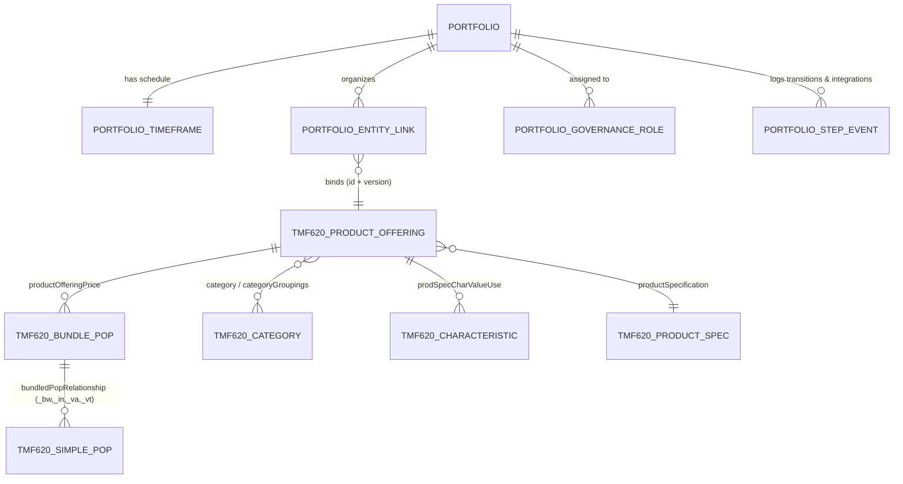

# Portfolio Entity Data Model (Catalog-Aligned)

> **Source Context**: Aligned with [lifecyclePmanagement.md](./lifecyclePmanagement.md), [lcm_ai_requirements.md](./lcm_ai_requirements.md), and the existing Catalog Section TMF620 model (`SalesPackageDetailTemplate.jsx`, `SalesPackageNewDetailTemplate.jsx`, `salesPackageBuilderService.js`, `leftMenuConfig.json`).

---

## 1. Entity-Relationship Overview

---

## 2. Core Entity: `Portfolio`

| Field | Type | Required | Description |
| :--- | :--- | :--- | :--- |
| `id` | `UUID / String` | Yes | Immutable system identifier (e.g., `ptf-vfde-2027-q3-mobile`). |
| `code` | `String` | Yes | Unique human-readable business code (e.g., `VFDE-2027Q3-MOB`). |
| `name` | `String` | Yes | Display name (e.g., `Vodafone Germany Consumer Mobile Q3 2027`). |
| `description` | `Text` | No | Commercial purpose and scope summary. |
| `businessLine` | `Enum` | Yes | Vodafone Germany domain (`Consumer_Mobile`, `Consumer_Fixed`, `Enterprise`, `Converged`). |
| `portfolioType` | `Enum` | Yes | `New_Business_Portfolio`, `Seasonal_Release`, `Campaign_Portfolio`, `Maintenance_Update`. |
| `status` | `Enum` | Yes | `Planning`, `Preparation`, `Readiness_Check`, `Active`, `Sunset`, `Archived`. |
| `parentPortfolioId` | `UUID` | No | Optional reference to group releases under a long-lived business portfolio umbrella. |
| `createdBy` | `String` | Yes | User ID of creator. |
| `createdAt` | `ISO8601` | Yes | Creation timestamp. |
| `updatedAt` | `ISO8601` | Yes | Last modification timestamp. |

---

## 3. Sub-Entities

### 3.1 `PortfolioTimeframe` (1:1 with `Portfolio`)
Governs the preparation lead time, readiness gate, commercial launch, and retirement schedule.

| Field | Type | Required | Description |
| :--- | :--- | :--- | :--- |
| `portfolioId` | `UUID` | Yes | FK to `Portfolio.id`. |
| `preparationStartDate` | `ISO8601` | Yes | When commercial authoring and Catalog Section alignment begin. |
| `readinessGateDate` | `ISO8601` | Yes | Target deadline for all linked offers and Catalog dependencies to be `Ready`. |
| `launchDate` | `ISO8601` | Yes | Planned/actual commercial go-live date (`Active`). |
| `sunsetDate` | `ISO8601` | No | End-of-sale date (`Sunset`), stopping new acquisitions while keeping existing subscribers. |
| `endDate` | `ISO8601` | No | Full retirement date (`Archived`). |

### 3.2 `PortfolioEntityLink` (1:N with `Portfolio`) — Catalog Section Binding
Binds a `Portfolio` to a specific version of an existing Catalog `ProductOffering` (e.g., a Sales Package).

| Field | Type | Required | Description |
| :--- | :--- | :--- | :--- |
| `id` | `UUID` | Yes | Link identifier. |
| `portfolioId` | `UUID` | Yes | FK to `Portfolio.id`. |
| `catalogEntityType` | `Enum` | Yes | `ProductOffering` (aligned with TMF620 Catalog Explorer). |
| `commercialSubType` | `Enum` | Yes | `SalesPackage`, `Hardware`, `Option`, `Bundle` (matches `leftMenuConfig.json` `subFilter`). |
| `catalogEntityId` | `String` | Yes | Existing Catalog `ProductOffering.id` (e.g., `po_dsl_16_v2`). |
| `targetVersion` | `String` | Yes | Specific version/draft bound to this portfolio (matches `ProductOffering.version`). |
| `effectiveFrom` | `ISO8601` | Yes | Offer validity start within the portfolio timeframe (`validFor.startDateTime`). |
| `effectiveTo` | `ISO8601` | No | Offer validity end within the portfolio timeframe (`validFor.endDateTime`). |
| `commercialPartStatus` | `Enum` | Yes | `Pending`, `In_Progress`, `Approved` (Categories, Characteristics, Spec, Terms). |
| `billingPartStatus` | `Enum` | Yes | `Pending`, `In_Progress`, `Approved` (Bundle POPs + Simple POPs `_bw`, `_in`, `_va`, `_vt`). |
| `linkStatus` | `Enum` | Yes | `In_Progress`, `Ready`, `Blocked_Tech_Dependency`, `Deferred`, `Published`. |
| `deferredToPortfolioId` | `UUID` | No | Target portfolio if deferred at `Readiness_Check` (`DEC-3`). |
| `deferralReason` | `Text` | No | Mandatory audit reason when `linkStatus = Deferred`. |

### 3.3 `PortfolioGovernanceRole` (1:N with `Portfolio`)
Tracks accountable people/roles per portfolio.

| Field | Type | Required | Description |
| :--- | :--- | :--- | :--- |
| `id` | `UUID` | Yes | Assignment ID. |
| `portfolioId` | `UUID` | Yes | FK to `Portfolio.id`. |
| `role` | `Enum` | Yes | `Portfolio_Manager`, `Release_Manager`, `Technical_Lead`, `Commercial_Lead`, `Billing_Lead`, `Compliance_Owner`. |
| `assigneeId` | `String` | Yes | User or group identifier. |

### 3.4 `PortfolioStepEvent` (1:N with `Portfolio`)
Immutable audit trail of Portfolio status changes and inbound/outbound integrations (`REQ-6.1`).

| Field | Type | Required | Description |
| :--- | :--- | :--- | :--- |
| `id` | `UUID` | Yes | Event ID. |
| `portfolioId` | `UUID` | Yes | FK to `Portfolio.id`. |
| `fromStatus` | `Enum` | No | Previous Portfolio status. |
| `toStatus` | `Enum` | Yes | New Portfolio status. |
| `integrationId` | `String` | No | ID of triggered inbound/outbound integration. |
| `direction` | `Enum` | No | `Inbound`, `Outbound`, `Internal`. |
| `integrationStatus` | `Enum` | No | `Pending`, `Success`, `Failed`, `Acknowledged`. |
| `actorId` | `String` | Yes | User or external system that triggered the event. |
| `timestamp` | `ISO8601` | Yes | Event timestamp. |

---

## 4. Mapping Sales Package's Two-Step LCM to the Catalog Model

| Sales Package LCM Step | Owner Role | Existing Catalog Model Fields Governed |
| :--- | :--- | :--- |
| **Step 1: Commercial Part** | `Commercial_Lead` / Product Manager | `ProductOffering` metadata, `productSpecification`, `category` & `extensions.categoryGroupings`, `prodSpecCharValueUse` (commercial characteristics), `productOfferingTerm`, `bundledProductOffering` |
| **Step 2: Billing Part** | `Billing_Lead` / Pricing Specialist | `productOfferingPrice` (**Bundle POPs**) → `bundledPopRelationship` (**Simple POPs** `_bw`, `_in`, `_va`, `_vt`), tariff codes, PSM packet codes, product codes |
