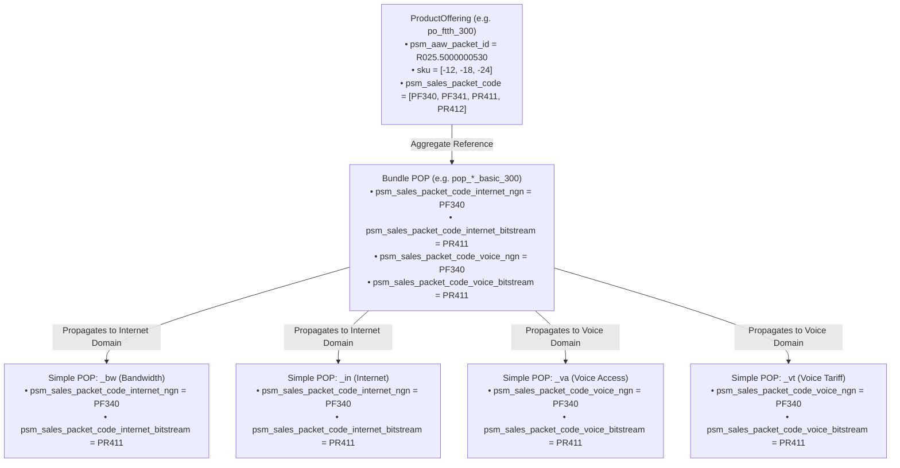

# Sales Package Pricing Model Specification (TMF620)
**Vodafone Germany (VFDE) FTTH & DSL Transformation**  
*Source Document: VFDEPC FTTH/DSL Transformation Reference Architecture (`po_ftth_300`, `po_dsl_16`, `vfde_catalog_reference.db`)*

---

## 1. Executive Summary & Core Architectural Principles

In the Vodafone Germany Fixed Network (FN) digital transformation to TM Forum Open APIs (TMF620 Product Catalog Management), broadband sales packages (such as **GigaZuhause FTTH** and **DSL**) transition from legacy billing structures (CCB, AAW, OSF) into a unified, modular catalog architecture.

This specification documents how the **Pricing Structure is defined, decomposed, and linked** for Sales Packages.

```mermaid
graph TD
    subgraph Specification Layer
        PS["ProductSpecification<br/><b>productSpecification_FN_SalesPackage_FTTH / DSL</b><br/>(61 Characteristics, version 0)"]
    end

    subgraph Offering Layer
        PO["ProductOffering<br/><b>GigaZuhause Sales Package</b> (po_ftth_300 / po_dsl_16)<br/>• isBundle = false<br/>• isSellable = true<br/>• Consolidates 3 legacy SKUs (-12, -18, -24)"]
        POT["ProductOfferingTerm<br/><b>Minimum Contract Duration</b><br/>• 12 Month (SKU-12)<br/>• 18 Month (SKU-18)<br/>• 24 Month (SKU-24)"]
        CG["Category Groupings<br/><b>extensions.categoryGroupings</b><br/>• SKU-qualified category trees"]
    end

    subgraph Pricing Layer - Tier 1: Composite Bundle POPs
        BPOP1["Bundle POP: Basic<br/><b>pop_*_bundle_mcd0_pt2_basic_*</b><br/>• isBundle = true<br/>• connection_type = basic<br/>• play_type = 2 (Dual Play)<br/>• Total: €49.99 (FTTH) / €34.99 (DSL)"]
        BPOP2["Bundle POP: Comfort<br/><b>pop_*_bundle_mcd0_pt2_comfort_*</b><br/>• isBundle = true<br/>• connection_type = comfort<br/>• play_type = 2 (Dual Play)<br/>• Total: €53.98 (FTTH) / €38.98 (DSL)"]
    end

    subgraph Pricing Layer - Tier 2: Atomic Simple POPs (4-Component Decomposition)
        BW["Simple POP: Bandwidth (_bw)<br/>• Internet codes only<br/>• FTTH: €15.00 / DSL: €0.00"]
        IN["Simple POP: Internet (_in)<br/>• Internet codes only<br/>• €14.00 / month"]
        VA["Simple POP: Voice Access (_va)<br/>• Voice codes only<br/>• Basic: €15.99 / Comfort: €19.98"]
        VT["Simple POP: Voice Charge (_vt)<br/>• Voice codes only<br/>• €5.00 / month"]
    end

    PS -->|Defines Schema & Characteristics| PO
    PO -->|Enforces Selling Terms| POT
    PO -->|Organizes in Catalog| CG
    PO -->|References via productOfferingPrice| BPOP1
    PO -->|References via productOfferingPrice| BPOP2

    BPOP1 -->|bundledPopRelationship| BW
    BPOP1 -->|bundledPopRelationship| IN
    BPOP1 -->|bundledPopRelationship| VA
    BPOP1 -->|bundledPopRelationship| VT

    BPOP2 -->|bundledPopRelationship| BW
    BPOP2 -->|bundledPopRelationship| IN
    BPOP2 -->|bundledPopRelationship| VA
    BPOP2 -->|bundledPopRelationship| VT
```

### Key Architectural Principles:

1. **Atomic Commercial Offering (`isBundle: false`, `isSellable: true`)**:
   Even though a Sales Package contains internet, voice, and hardware options, the commercial offering itself is an **atomic offering** (`isBundle: false`), representing multiple legacy billing SKUs under a single product code.
2. **Decoupling Selling Terms from Pricing Duration (`mcd0`)**:
   Contract durations (12, 18, 24 months) are modeled in `productOfferingTerm` attached to the offering. The monthly recurring pricing is **duration-neutral** (`mcd0` = minimum contract duration 0). The customer pays the same monthly recurring price regardless of contract commitment length.
3. **Two-Tier Composite Pricing Decomposition**:
   A Sales Package does **not** link directly to flat price tags. It links to **Composite Bundle POPs** (`isBundle: true`), which in turn aggregate exactly **four atomic Simple POPs** (`isBundle: false`) via `bundledPopRelationship`.
4. **The 4-Component Decomposition Pattern**:
   Every pricing bundle is decomposed into four discrete financial components:
   - `_bw` (Bandwidth Component)
   - `_in` (Internet Component)
   - `_va` (Voice Access Component)
   - `_vt` (Voice Charge / Usage Component)
5. **Dual-Network Billing Translation (NGN vs. Bitstream)**:
   Every simple POP carries legacy CCB/AAW provisioning codes for both **NGN** (Vodafone own-infrastructure) and **Bitstream** (Deutsche Telekom wholesale access) networks.

---

## 2. Offering & Specification Layer Structure

### 2.1 Product Offering Identification & Flags
- **`isBundle = false`**: Declared as a simple offering in TMF620 to differentiate commercial broadband tariffs from composite bundle carts.
- **`isSellable = true`**: Indicates the sales package is directly orderable in sales channels (OSF / eShop / Retail).
- **`product_family_id = FNFamily2`**: Standard Vodafone Fixed Network Family identifier.
- **Legacy SKU Consolidation**: A single `ProductOffering` consolidates **3 legacy SKUs** corresponding to minimum contract duration variations:
  - `-12` (12 months commitment)
  - `-18` (18 months commitment)
  - `-24` (24 months commitment)

### 2.2 Selling Terms (`ProductOfferingTerm`)
Duration commitments are defined as terms on the offering, pointing to legacy CCB Packet IDs:

| Contract Duration | SKU Reference (FTTH 300) | SKU Reference (DSL 16) | Description |
| :--- | :--- | :--- | :--- |
| **12 Month** | `R025.5000000530-12` | `R025.5000000073-12` | 1-year minimum commitment |
| **18 Month** | `R025.5000000530-18` | `R025.5000000073-18` | 1.5-year promotional commitment |
| **24 Month** | `R025.5000000530-24` | `R025.5000000073-24` | Standard 2-year commitment |

### 2.3 Category Groupings (`extensions.categoryGroupings`)
Each SKU commitment has an associated category grouping in the catalog taxonomy:
- **FTTH 300**: 3 SKU-qualified groups across **13 distinct categories** (`FN0355`, `FN0473`, `FN0503`, `FN0507`, `FN0511`, `FN0523`, `FN0544`, `FN0550`, `FN0553`, `FN0590`, `FN155`, `FN186`, `FN74`).
- **DSL 16**: 3 SKU-qualified groups across **11 distinct categories** (`FN0355`, `FN0515`, `FN0548`, `FN0552`, `FN0639`, `FN155`, `FN37`, `FN38`, `FN39`, `FN74`, `FN76`).

---

## 3. The Pricing Model Architecture

### 3.1 Two-Tier POP Hierarchy

The pricing model separates commercial price presentation from billing revenue distribution:

```
ProductOffering (e.g. po_ftth_300)
    │
    ├── productOfferingPrice[] (References Bundle POPs)
    │     │
    │     ├── [Tier 1] pop_ftth_300_bundle_mcd0_pt2_basic_300 (isBundle: true, Total: €49.99)
    │     │      ├── [Tier 2] ..._bw (Bandwidth: €15.00)
    │     │      ├── [Tier 2] ..._in (Internet: €14.00)
    │     │      ├── [Tier 2] ..._va (Voice Access: €15.99)
    │     │      └── [Tier 2] ..._vt (Voice Charge: €5.00)
    │     │
    │     └── [Tier 1] pop_ftth_300_bundle_mcd0_pt2_comfort_300 (isBundle: true, Total: €53.98)
    │            ├── [Tier 2] ..._bw (Bandwidth: €15.00)
    │            ├── [Tier 2] ..._in (Internet: €14.00)
    │            ├── [Tier 2] ..._va (Voice Access: €19.98)
    │            └── [Tier 2] ..._vt (Voice Charge: €5.00)
```

### 3.2 Bundle POP Naming & Parameter Convention

Bundle POP identifiers follow a strict deterministic naming pattern:
$$\text{pop\_}[\text{tech}]\_[\text{speed}]\_\text{bundle\_mcd}[\text{duration}]\_\text{pt}[\text{play}]\text{\_}[\text{connection\_type}]\_[\text{variant\_speed}]$$

Example: `pop_ftth_300_bundle_mcd0_pt2_basic_300`
- `ftth_300`: Technology and base tier speed (300 Mbit/s)
- `mcd0`: Minimum Contract Duration = 0 (Duration-neutral price)
- `pt2`: Play Type = 2 (Dual Play: Broadband Internet + Voice)
- `basic`: Connection Type (`basic` = 1 voice line; `comfort` = ISDN multi-number / 2 voice lines)
- `300`: Active bandwidth tier (300 Mbit/s)

### 3.3 The 4-Component Decomposition Model

Each Bundle POP groups **exactly 4 simple atomic price components** (`bundledPopRelationship[]`).  
Every simple POP is identified by appending a suffix to the parent bundle POP ID:

| Component Suffix | Component Name | Financial Role | Network Codes Assigned |
| :--- | :--- | :--- | :--- |
| `_bw` | **Bandwidth Fee** | Physical line / speed tier charge | Internet codes only |
| `_in` | **Internet Fee** | IP transit & ISP service charge | Internet codes only |
| `_va` | **Voice Access Fee** | Telephone line provision (Basic vs. Comfort) | Voice codes only |
| `_vt` | **Voice Charge** | Voice flat / tariff charge | Voice codes only |

All atomic prices share standard financial attributes:
- **Price Type**: `Recurring charge`
- **Period**: `monthly` (`recurringChargePeriodType: month`, `recurringChargePeriodLength: 1`)
- **Unit**: `EUR`
- **Pricing Category**: `Fee`
- **Tax Rate**: `19%` (German VAT, `taxCategory: vat`)

---

## 4. Network Provisioning, CCB Integration & PSM Packet Codes

To interface with Vodafone Germany's legacy BSS/OSS architecture—specifically **CCB (Customer Care and Billing)**, **AAW (Auftragserfassung und Auftragsabwicklung - Order Management)**, and **OSF (Order Support Framework)**—TMF620 entities encode legacy billing and packet codes within `prodSpecCharValueUse` characteristics across both the Offering and Pricing layers.

### 4.1 Distinction: Master Packet ID vs. Sales Packet Codes

It is critical to distinguish between the two levels of packet identifiers:

1. **Master Packet ID (`psm_aaw_packet_id`) — Offering Level**:
   - Represents the top-level commercial sales bundle in CCB/AAW (e.g. `R025.5000000530` for FTTH 300, `R025.5000000073` for DSL 16).
   - Serves as the base prefix to derive the **SKUs** for contract commitment variants:
     - `psm_aaw_packet_id + "-12"` $\to$ `R025.5000000530-12` (12 Month Contract)
     - `psm_aaw_packet_id + "-18"` $\to$ `R025.5000000530-18` (18 Month Contract)
     - `psm_aaw_packet_id + "-24"` $\to$ `R025.5000000530-24` (24 Month Contract)
   - Stored on the `ProductOffering` characteristics and referenced in `productOfferingTerm`.

2. **Sales Packet Codes (`psm_sales_packet_code_*`) — Pricing Level**:
   - Represents the technical billing & network provisioning packets in CCB (e.g. `PF340`, `PR411`, `PI208`, `PR383`).
   - Mapped on the **Bundle POPs** and propagated to child **Simple POPs**.
   - Varies across three distinct dimensions:
     - **Connection Type**: `Basic` (1 line) vs. `Comfort` (multi-number ISDN)
     - **Access Network**: `NGN` (Vodafone owned network) vs. `Bitstream` (Telekom wholesale access)
     - **Bandwidth Profile**: In DSL, varies per fallback speed tier (16, 6, 3, 2, 1 Mbit/s) to configure DSLAM port line profiles.

### 4.2 PSM Packet Code Resolution Hierarchy



### 4.3 Parameter & Code Assignment Matrix

| Entity Level | Characteristic Name | Scope / Role | Example (FTTH 300 Basic) | Example (DSL 16 Basic) |
| :--- | :--- | :--- | :--- | :--- |
| **Offering** | `psm_aaw_packet_id` | Master CCB bundle packet ID | `R025.5000000530` | `R025.5000000073` |
| **Offering** | `sku` | Contract term SKU list | `R025...-12`, `-18`, `-24` | `R025...-12`, `-18`, `-24` |
| **Offering** | `psm_sales_packet_code` | Aggregated list of all packet codes | `["PF340","PF341","PR411","PR412"]` | `["PI208","PR383",...]` |
| **Bundle POP** | `psm_sales_packet_code_internet_ngn` | Internet NGN packet code | `PF340` | `PI208` (at 16 Mbit/s) |
| **Bundle POP** | `psm_sales_packet_code_internet_bitstream` | Internet Bitstream packet code | `PR411` | `PR383` (at 16 Mbit/s) |
| **Bundle POP** | `psm_sales_packet_code_voice_ngn` | Voice NGN packet code | `PF340` | `PI208` (at 16 Mbit/s) |
| **Bundle POP** | `psm_sales_packet_code_voice_bitstream` | Voice Bitstream packet code | `PR411` | `PR383` (at 16 Mbit/s) |
| **Simple `_bw` / `_in`** | `psm_sales_packet_code_internet_ngn` | Internet NGN provisioning | `PF340` | `PI208` |
| **Simple `_bw` / `_in`** | `psm_sales_packet_code_internet_bitstream` | Internet Bitstream provisioning | `PR411` | `PR383` |
| **Simple `_va` / `_vt`** | `psm_sales_packet_code_voice_ngn` | Voice NGN provisioning | `PF340` | `PI208` |
| **Simple `_va` / `_vt`** | `psm_sales_packet_code_voice_bitstream` | Voice Bitstream provisioning | `PR411` | `PR383` |

### 4.4 Technical Function of Packet Codes in Downstream Provisioning
- **Why do packet codes change across bandwidths in DSL when the commercial price is identical (€34.99)?**
  In CCB/AAW, order lines dispatch network configuration requests based on the combination of:
  $$\text{Packet Code} + \text{Service Code}$$
  For example, at 16 Mbit/s Bitstream, AAW activates Packet `PR383` + Bandwidth Service `V018C`. At 6 Mbit/s Bitstream, it activates Packet `PR381` + Bandwidth Service `V0178`.  
  This triggers the wholesale Telekom API to cap the DSLAM sync profile at the corresponding downstream speed while maintaining the customer's agreed commercial tariff.
- **Prefix Conventions**:
  - `PF*`: Fixed Fibre NGN Packets (e.g. `PF340`, `PF341`)
  - `PI*`: Fixed Internet NGN Packets (e.g. `PI202` to `PI209`)
  - `PR*`: Fixed Resale / Bitstream Wholesale Packets (e.g. `PR373` to `PR384`, `PR411`, `PR412`)

### 4.5 Dual-Network Provisioning Code Conditions
For both Internet and Voice, codes are divided by physical access network:
- **NGN (Next Generation Network)**: Vodafone's owned network infrastructure.
  - `product_code_*_ngn` (e.g. Internet: `I1204`, Voice: `VI202`)
  - `tariff_code_*_ngn` (e.g. Internet: `IP530`/`IP073`, Voice: `VP530`/`VP073`)
  - `service_code_*_ngn` (e.g. Internet Bandwidth: `IG018`/`V018C`, Access: `V0017`, Voice: `VI002`/`VI003`)
- **Bitstream**: Wholesale lines leased from Deutsche Telekom (BSA / VULA).
  - `product_code_*_bitstream` (e.g. Internet: `I1203`, Voice: `VI203`)
  - `tariff_code_*_bitstream` (e.g. Internet: `IP530`/`IP073`, Voice: `VP530`/`VP073`)
  - `service_code_*_bitstream` (e.g. Internet Bandwidth: `IG018`/`V018C`, Access: `V0017`, Voice: `VI009`/`VI006`)

---

## 5. Detailed Comparative Analysis: FTTH 300 vs. DSL 16

### 5.1 Case Study 1: GigaZuhause 300 Glasfaser (`po_ftth_300`)

FTTH delivers a guaranteed, symmetric/high-speed service where line fallback does not occur. Therefore, it has **only 2 bundle price variants** (Basic vs. Comfort).

#### Financial Rollup:
- **Basic Bundle**: **€49.99 / month**
- **Comfort Bundle**: **€53.98 / month**  
  *(Delta = +€3.99 / month for Comfort Voice Access)*

```
Basic:   €15.00 (_bw) + €14.00 (_in) + €15.99 (_va) + €5.00 (_vt) = €49.99 / month
Comfort: €15.00 (_bw) + €14.00 (_in) + €19.98 (_va) + €5.00 (_vt) = €53.98 / month
```

#### Detailed Component Matrix:

| Component ID | Suffix | Price (€) | Characteristic Conditions | NGN Network Codes | Bitstream Network Codes |
| :--- | :--- | :---: | :--- | :--- | :--- |
| **Bandwidth** | `_bw` | **€15.00** | `bandwidth: 300`<br/>`play_type: 2` | Prod: `I1204`<br/>Tariff: `IP530`<br/>Service: `IG018` | Prod: `I1203`<br/>Tariff: `IP530`<br/>Service: `IG018` |
| **Internet** | `_in` | **€14.00** | `bandwidth: 300`<br/>`play_type: 2` | Prod: `I1204`<br/>Tariff: `IP530`<br/>Service: `V0017` | Prod: `I1203`<br/>Tariff: `IP530`<br/>Service: `V0017` |
| **Voice Access (Basic)** | `_va` | **€15.99** | `connection_type: basic`<br/>`play_type: 2` | Prod: `VI202`<br/>Tariff: `VP530`<br/>Service: `VI002` | Prod: `VI203`<br/>Tariff: `VP530`<br/>Service: `VI009` |
| **Voice Access (Comfort)** | `_va` | **€19.98** | `connection_type: comfort`<br/>`play_type: 2` | Prod: `VI202`<br/>Tariff: `VP530`<br/>Service: `VI003` | Prod: `VI203`<br/>Tariff: `VP530`<br/>Service: `VI006` |
| **Voice Charge** | `_vt` | **€5.00** | `play_type: 2` | Prod: `VI202`<br/>Tariff: `VP530`<br/>Service: `V0017` | Prod: `VI203`<br/>Tariff: `VP530`<br/>Service: `V0017` |

#### Packet Codes (Assigned on Bundle POP):
- **Basic (`pop_*_basic_300`)**: NGN = `PF340` | Bitstream = `PR411`
- **Comfort (`pop_*_comfort_300`)**: NGN = `PF341` | Bitstream = `PR412`

---

### 5.2 Case Study 2: GigaZuhause 16 DSL (`po_dsl_16`)

Unlike FTTH, copper DSL speeds depend on loop physical distance and line attenuation. The offering declares fallback bandwidths:
- `default_bandwidth = 16`
- `fallback_bandwidth = 6, 3, 2, 1`

Because of this physical reality, **DSL 16 requires 10 Bundle Price Variants** ($2 \text{ connection types} \times 5 \text{ bandwidth levels} = 10 \text{ bundles}$):
- 5 Basic Bundles (€34.99 / month each for 16, 6, 3, 2, 1 Mbit/s)
- 5 Comfort Bundles (€38.98 / month each for 16, 6, 3, 2, 1 Mbit/s)

#### Key DSL Pricing Peculiarities:
1. **Bandwidth Fee is €0.00**:  
   Across all 10 DSL variants, `_bw` has a fee of **€0.00**. Instead of varying the monthly price, **the line speed rate is adapted by varying the Service Code (`V018C`, `V0178`, etc.) and Packet Code (`PI*`, `PR*`)**.
2. **Fixed Commercial Price**:  
   Customers pay the identical commercial tariff (€34.99 Basic / €38.98 Comfort) regardless of whether physical line conditions achieve 16, 6, 3, 2, or 1 Mbit/s.
3. **Bandwidth 3 NGN Exclusion**:  
   3 Mbit/s is not offered on Vodafone's own NGN network; it is exclusively a Bitstream fallback. NGN code assignments for 3 Mbit/s are marked `-`.

#### Financial Rollup:
```
Basic:   €0.00 (_bw) + €14.00 (_in) + €15.99 (_va) + €5.00 (_vt) = €34.99 / month
Comfort: €0.00 (_bw) + €14.00 (_in) + €19.98 (_va) + €5.00 (_vt) = €38.98 / month
```

#### Common Product & Tariff Codes (Shared Across All 10 Bundles):
- **Internet (`_bw`, `_in`)**:
  - NGN: Product `I1204`, Tariff `IP073`
  - Bitstream: Product `I1203`, Tariff `IP073`
- **Voice (`_va`, `_vt`)**:
  - NGN: Product `VI202`, Tariff `VP073`
  - Bitstream: Product `VI203`, Tariff `VP073`

#### Bandwidth Service Code Matrix (`_bw`):
The Bandwidth Component (`_bw`) dynamically shifts its service code to provision the correct DSL line profile in the DSLAM:

| Bandwidth Tier | NGN Bandwidth Service Code | Bitstream Bandwidth Service Code | Price |
| :--- | :---: | :---: | :---: |
| **16 Mbit/s** | `V018C` | `V018C` | €0.00 |
| **6 Mbit/s** | `V0178` | `V0178` | €0.00 |
| **3 Mbit/s** | *(unsupported)* `-` | `V0175` | €0.00 |
| **2 Mbit/s** | `V0174` | `V0174` | €0.00 |
| **1 Mbit/s** | `V0118` | `V0118` | €0.00 |

#### Packet Code Matrix Across All 10 Bundles:

| Bandwidth | Basic NGN Packet | Basic Bitstream Packet | Comfort NGN Packet | Comfort Bitstream Packet |
| :---: | :---: | :---: | :---: | :---: |
| **16 Mbit/s** | `PI208` | `PR383` | `PI209` | `PR384` |
| **6 Mbit/s** | `PI206` | `PR381` | `PI207` | `PR382` |
| **3 Mbit/s** | `-` | `PR379` | `-` | `PR380` |
| **2 Mbit/s** | `PI204` | `PR377` | `PI205` | `PR378` |
| **1 Mbit/s** | `PI202` | `PR373` | `PI203` | `PR374` |

---

## 6. Synthesis: How the Pricing Model is Created for Sales Packages

To create or generate a compliant Sales Package pricing model in DNEXT / TMF620, the following procedural rules must be applied:

### Step 1: Define the Commercial Offering
1. Set `entityType: "ProductOffering"`, `isBundle: false`, `isSellable: true`.
2. Associate the relevant `ProductSpecification` (`productSpecification_FN_SalesPackage_FTTH` or `_DSL`).
3. Define the SKU selling terms in `productOfferingTerm` (`12 Month`, `18 Month`, `24 Month`).
4. Bind SKU category groupings under `extensions.categoryGroupings`.

### Step 2: Determine Pricing Variants Dimension
- Identify whether the technology supports fallback bandwidths:
  - **Single Bandwidth (FTTH / Cable)**: $N_{\text{bundles}} = 2$ (`basic`, `comfort`).
  - **Multi Bandwidth (DSL)**: $N_{\text{bundles}} = 2 \times N_{\text{bandwidths}}$ (e.g. $2 \times 5 = 10$).

### Step 3: Instantiate Composite Bundle POPs (Tier 1)
For each variant combination $(C \in \{\text{basic}, \text{comfort}\}, B \in \text{Bandwidths})$:
1. Create a `ProductOfferingPrice` entity with:
   - `isBundle: true`
   - `priceType: "Recurring charge"`
   - `recurringChargePeriodType: "month"`
   - `price.value`: Aggregate sum (€49.99 / €53.98 for FTTH; €34.99 / €38.98 for DSL).
   - `prodSpecCharValueUse`: `connection_type: C`, `bandwidth: B`, `play_type: "2"`.
   - Assign the corresponding NGN and Bitstream Packet Codes (`PF*`, `PI*`, `PR*`).

### Step 4: Decompose into 4 Simple POP Components (Tier 2)
Under each Bundle POP, instantiate and link 4 simple POPs via `bundledPopRelationship`:
1. **`_bw` (Bandwidth Component)**:
   - Price: €15.00 for FTTH; €0.00 for DSL.
   - Suffix: `${bundleId}_bw`.
   - Set NGN/Bitstream Internet Product (`I1204`/`I1203`), Tariff (`IP530`/`IP073`), and Service codes.
2. **`_in` (Internet Component)**:
   - Price: €14.00.
   - Suffix: `${bundleId}_in`.
   - Set Internet Service Code `V0017`.
3. **`_va` (Voice Access Component)**:
   - Price: €15.99 (Basic) or €19.98 (Comfort).
   - Suffix: `${bundleId}_va`.
   - Set Voice Access Service Codes (`VI002`/`VI009` for Basic; `VI003`/`VI006` for Comfort).
4. **`_vt` (Voice Charge Component)**:
   - Price: €5.00.
   - Suffix: `${bundleId}_vt`.
   - Set Voice Charge Service Code `V0017`.

### Step 5: Wire Relationships in Catalog
1. Add references to all Tier 1 Bundle POPs into the `ProductOffering.productOfferingPrice[]` array.
2. Ensure simple atomic POPs are **not** referenced directly on the `ProductOffering`; they must reside strictly inside the `bundledPopRelationship[]` of their parent Bundle POP.
3. Validate rollup integrity:
   $$\sum_{i \in \{\text{bw}, \text{in}, \text{va}, \text{vt}\}} \text{Price}(\text{Simple POP}_i) \equiv \text{Price}(\text{Bundle POP})$$
