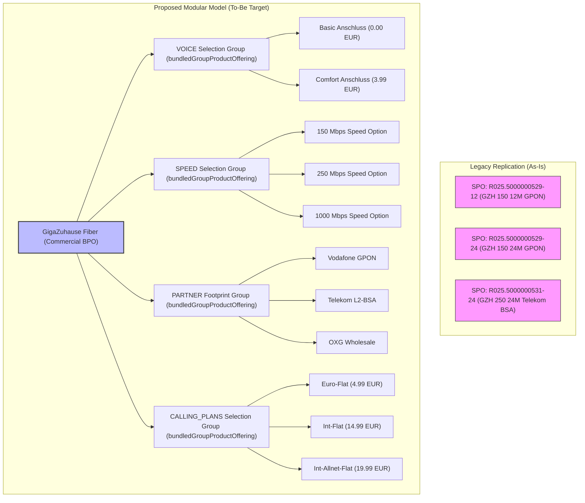
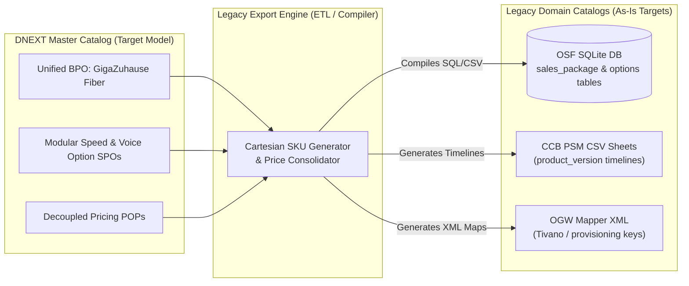

# Solution Architecture Proposal: Germany Product Catalog Redesign

This document provides an architectural critique of the current **Vodafone Germany Fixed-Net (FN) Product Catalog** mapping into the **DNEXT TMF 620 target model**, and proposes a highly modular, flexible, and future-proof catalog design. 

---

## 1. Executive Summary: The Transition from "Replication" to "Transformation"

In the initial implementation phase of the DNEXT catalog, the target TMF 620 entities were structured as a **1:1 logical replication** of the legacy SQLite database (`vodafone_catalog.db`) relational tables. While this approach enabled quick initial mapping, it bypassed the structural benefits of TM Forum standards and imported legacy constraints directly into the new target BSS system.

To build a catalog that drives agility, reduces technical debt, and speeds up time-to-market (TTM), Vodafone Germany must transition from **Replication Mode** to **Transformation Mode**:



---

## 2. Key Structural Inefficiencies in the Current Model

A review of the sample offerings (e.g., [R025.5000000529-24.json](file:///Users/serdarsuleyman/Downloads/dnext/germany_revised/OSF-20251211_Version_775_FN_2025_12_08/scratch/sample_sales_package_offers/R025.5000000529-24.json) and [TVS01I1357OT.json](file:///Users/serdarsuleyman/Downloads/dnext/germany_revised/OSF-20251211_Version_775_FN_2025_12_08/scratch/sample_installation_package_offers/TVS01I1357OT.json)) reveals several design limitations:

### Anti-Pattern 1: Monolithic Simple Product Offerings (`isBundle: false`)
The current sales packages are defined as flat Simple Product Offerings (SPOs). They embed speed variables, access options, and technical codes (like `VoiceTariffCode = VP529` and `InternetTariffCode = IP529`) into a single file. 
* **Impact**: Commercial changes (e.g., updating a marketing name or cart description) require re-deploying files containing downstream network codes, risking billing system validation errors.

### Anti-Pattern 2: SKU Proliferation through Suffix and Prefix Cloning
To accommodate different options, the catalog clones and prefixes/suffixes base offerings:
* Tariffs are cloned for every catalog release prefix (e.g., `R025...` vs. `R219...`) and contract duration (e.g., `-12`, `-18`, `-24`).
* Setup fees are cloned and prefixed (e.g., `V0050V0134OT` through `V0210V0134OT`) to bind them to specific packages.
* **Impact**: Maintaining, versioning, and auditing thousands of files for minor variation updates becomes highly complex.

### Anti-Pattern 3: Procedural Rules and Virtual Category Overloading
Technology compatibility (GPON vs. Telekom BSA) is determined by assigning offerings to multiple virtual categories (e.g., `FN0511` for DTAG wholesale). Validation checks rely on custom SQL queries or script-based rules engines instead of native TMF containment relationships.
* **Impact**: Adding a new partner footprint or speed tier requires rewriting external rules, making catalog management fragile.

### Anti-Pattern 4: Billing System Leakage into the Front-End Catalog
Purely technical billing breakdown codes (which have `0.00 €` charges and are invisible to the customer) are modeled as storefront-sellable option SKUs.
* **Impact**: Creates catalog bloat and increases shopping cart validation overhead.

---

## 3. The Proposed Target Solution Architecture

To resolve these limitations, we propose a modular catalog architecture based on TM Forum standards (TMF 620):

### 3.1. Unified Commercial Offerings (Release-Independent BPOs)
Instead of creating dozens of cloned SPOs for every speed, contract duration, and release, we define a single **Unified Bundled Product Offering (BPO)** for each primary access technology (e.g., **`GigaZuhause Glasfaser`** and **`GigaZuhause DSL`**):

1. **Duration Parameterization**: Contract duration is modeled as a configurable characteristic (**`ContractDuration`**) on the parent BPO. The storefront/CPQ maps the selected term (12 vs. 24 months) to dynamic price points.
2. **Release Decoupling**: Release-specific prefixing is retired. Versioning is managed natively via the TMF `version` and `lifecycleStatus` attributes, keeping the primary SKU code static.

### 3.2. Declarative Bundling and Containment (TMF 620 Bundling)
The unified `GigaZuhause Glasfaser` BPO utilizes native **`bundledGroupProductOffering`** (Selection Groups) to structure selections directly in the offering:

```
[ GigaZuhause Glasfaser (BPO) ]
    ├── [ SPEED_TIERS (bundledGroupProductOffering) ] -> Cardinality: 1..1
    │     ├── GigaZuhause 150 Glasfaser Speed Option (SPO)
    │     ├── GigaZuhause 250 Glasfaser Speed Option (SPO)
    │     └── GigaZuhause 1000 Glasfaser Speed Option (SPO)
    │
    ├── [ VOICE_ACCESS (bundledGroupProductOffering) ] -> Cardinality: 1..1
    │     ├── Basis-Anschluss (SPO) [0.00 €] (Default)
    │     └── Komfort-Anschluss (SPO) [3.99 €]
    │
    ├── [ NETWORK_FOOTPRINTS (bundledGroupProductOffering) ] -> Cardinality: 1..1
    │     ├── GPON On-Net Access (SPO) (Auto-selected by Feasibility)
    │     └── Telekom BSA Access (SPO) (Auto-selected by Feasibility)
    │
    └── [ HARDWARE_COMPATIBILITY (productOfferingRelationship) ] -> (Optional Standalone)
          └── FRITZ!Box 7690 (Lease SPO) [8.99 €] (Restricted by Rule: Requires Fiber Line)
```

* **Voice Selection**: Cardinality controls (`lowerLimit = 1, upperLimit = 1`) enforce that the customer selects exactly one voice access option.
* **Speed Selection**: Bandwidth tiers are separated into standalone SPO options, making it simple to add or adjust speeds without re-cloning the entire bundle configuration.

### 3.3. Separation of Commercial vs. Technical Attributes (TMF 620 Schema Best Practice)
To keep the commercial catalog agile, we ensure a clean separation between commercial (storefront-facing) attributes and technical (spec-facing) characteristics:

1. **Commercial Offering Layer (`ProductOffering`)**: Holds customer-facing metadata used by storefronts (e.g., marketing names, description summaries, and price structures).
2. **Technical Specification Layer (`ProductSpecification`)**: Holds static capability parameters (e.g., upload/download speeds, carrier footprint technologies, and hardware configuration defaults).

This separation ensures marketing teams can update storefront descriptions and campaign texts directly on the offerings without altering the underlying technical specifications that map to billing and legacy provisioning targets.

### 3.4. Decoupled Pricing (Matrix Pricing & Dynamic POPs)
We separate product offerings from their pricing to enable reuse and agility:

1. **Dynamic Setup Fee Injection**: Setup fees are defined as standalone offerings (e.g., `IT002OT` for Fiber Installation) and injected into the cart using rules, rather than prefix-cloned across multiple sales packages.
2. **Promotional Price Waivers**: Instead of cloning offerings to define promotional rates, we use campaign rules to apply a promotional credit (e.g., `pop-discount-99E` for a `-99.00 €` waiver) alongside the base fee in the cart.
3. **Decoupled Pricing (POP) Catalog**: Recurring charges are managed in a decoupled pricing catalog. The CPQ resolves the monthly fee by checking a price matrix driven by offering characteristics (such as technology and duration):

| Base Offering | Technology | Duration | Target POP | Price (Gross) |
| :--- | :--- | :--- | :--- | :---: |
| `GigaZuhause Glasfaser` | `GPON` | `24 Months` | `pop-recurrent-gzh-fiber-24m` | `44.99 €` |
| `GigaZuhause Glasfaser` | `BSA_DTAG` | `24 Months` | `pop-recurrent-gzh-bsa-24m` | `49.99 €` |

---

## 4. Architectural Comparison: As-Is vs. Proposed To-Be

| Architectural Dimension | Current As-Is Model | Proposed To-Be Target Model | Architectural Value |
| :--- | :--- | :--- | :--- |
| **Broadband Offer Modeling** | Flat offerings (`isBundle: false`) duplicated for each speed, release, and duration. | Unified Bundled Product Offering (`isBundle: true`) bundling speed options. | Reduces file maintenance overhead and simplifies portfolio audits. |
| **Access Choice (Voice)** | Managed via external rules checking custom option SKU tables. | Native selection group (`bundledGroupProductOffering`) with cardinality limits. | Declarative, standards-aligned configuration validated natively in the cart. |
| **Duration Variant Handling** | Separate offerings cloned with suffixes (e.g., `-12` vs `-24`). | Unified offering with a configurable characteristic (`ContractDuration`). | Prevents SKU proliferation when terms or durations change. |
| **Technology Compatibility** | Determined by assigning offerings to multiple virtual category nodes. | Modeled via characteristics (`AccessTechnology`) and validation policies. | Keeps categories reserved for navigation; checks use robust metadata fields. |
| **Pricing Management** | Price is hardcoded and linked to specific cloned offerings. | Decoupled POP catalog with matrix-based resolution. | Enables reuse of pricing models and supports rapid promotional updates. |
| **Billing Integration** | Technical billing codes (`IP529`) are embedded in commercial offerings. | Generated dynamically by the Legacy Export Engine based on technical spec attributes. | Decouples marketing updates from billing-system validation logic. |

---

## 5. Concrete TMF 620 Schema Mockups

### 5.1. Target Modular Product Offering (BPO)
Below is a mockup of the unified `GigaZuhause Glasfaser` bundle, showing how speed tiers and voice options are grouped natively:

```json
{
  "id": "giga_zuhause_fiber_bundle",
  "name": "GigaZuhause Glasfaser",
  "version": "1.0",
  "lifecycleStatus": "Launched",
  "@type": "ProductOffering",
  "isBundle": true,
  "isSellable": true,
  "productSpecification": {
    "id": "VF_DE_SPEC_SALES_PACKAGE",
    "name": "VF_DE_Sales_Package_Specification",
    "@referredType": "ProductSpecification"
  },
  "category": [
    {
      "id": "FN0473",
      "name": "GigaZuhause Glasfaser",
      "@referredType": "Category"
    }
  ],
  "prodSpecCharValueUse": [
    {
      "name": "ContractDuration",
      "valueType": "string",
      "configurable": true,
      "productSpecCharacteristicValue": [
        { "value": "24", "isDefault": true },
        { "value": "12", "isDefault": false }
      ]
    }
  ],
  "bundledGroupProductOffering": [
    {
      "name": "SPEED_OPTIONS",
      "bundledGroupProductOfferingOption": {
        "numberRelOfferLowerLimit": 1,
        "numberRelOfferUpperLimit": 1
      },
      "bundledProductOffering": [
        {
          "id": "speed_150_mbps_opt",
          "name": "Glasfaser Bandbreite 150 Mbit/s",
          "bundledProductOfferingOption": {
            "numberRelOfferLowerLimit": 0,
            "numberRelOfferUpperLimit": 1,
            "numberRelOfferDefault": 0
          }
        },
        {
          "id": "speed_250_mbps_opt",
          "name": "Glasfaser Bandbreite 250 Mbit/s",
          "bundledProductOfferingOption": {
            "numberRelOfferLowerLimit": 0,
            "numberRelOfferUpperLimit": 1,
            "numberRelOfferDefault": 1
          }
        },
        {
          "id": "speed_1000_mbps_opt",
          "name": "Glasfaser Bandbreite 1000 Mbit/s",
          "bundledProductOfferingOption": {
            "numberRelOfferLowerLimit": 0,
            "numberRelOfferUpperLimit": 1,
            "numberRelOfferDefault": 0
          }
        }
      ]
    },
    {
      "name": "VOICE_ACCESS",
      "bundledGroupProductOfferingOption": {
        "numberRelOfferLowerLimit": 1,
        "numberRelOfferUpperLimit": 1
      },
      "bundledProductOffering": [
        {
          "id": "c_basic_spo",
          "name": "Basis-Anschluss",
          "bundledProductOfferingOption": {
            "numberRelOfferLowerLimit": 0,
            "numberRelOfferUpperLimit": 1,
            "numberRelOfferDefault": 1
          }
        },
        {
          "id": "c_comfort_spo",
          "name": "Komfort-Anschluss",
          "bundledProductOfferingOption": {
            "numberRelOfferLowerLimit": 0,
            "numberRelOfferUpperLimit": 1,
            "numberRelOfferDefault": 0
          }
        }
      ]
    },
    {
      "name": "HARDWARE_OPTIONS",
      "bundledGroupProductOfferingOption": {
        "numberRelOfferLowerLimit": 0,
        "numberRelOfferUpperLimit": 1
      },
      "bundledProductOffering": [
        {
          "id": "20090230_sub",
          "name": "FRITZ!Box 7690 (Mietgerät)",
          "bundledProductOfferingOption": {
            "numberRelOfferLowerLimit": 0,
            "numberRelOfferUpperLimit": 1,
            "numberRelOfferDefault": 0
          }
        },
        {
          "id": "20090240_sub",
          "name": "FRITZ!Box 5690 Glasfaser (Kaufgerät)",
          "bundledProductOfferingOption": {
            "numberRelOfferLowerLimit": 0,
            "numberRelOfferUpperLimit": 1,
            "numberRelOfferDefault": 0
          }
        },
        {
          "id": "20099900_sub",
          "name": "Eigenhardware Kunde",
          "bundledProductOfferingOption": {
            "numberRelOfferLowerLimit": 0,
            "numberRelOfferUpperLimit": 1,
            "numberRelOfferDefault": 1
          }
        }
      ]
    }
  ]
}
```

### 5.2. Target Decoupled Product Offering Price (POP)
Below is a mockup of a decoupled, reusable pricing object for the 250 Mbps fiber speed option:

```json
{
  "id": "pop-recurrent-speed-250m",
  "name": "Glasfaser Bandbreite 250 Mbit/s Monthly Fee",
  "version": "1.0",
  "lifecycleStatus": "Active",
  "priceType": "Recurring charge",
  "recurringChargePeriodType": "month",
  "price": {
    "value": 49.99,
    "unit": "EUR"
  },
  "tax": [
    {
      "taxCategory": "VAT",
      "taxRate": 19
    }
  ],
  "@type": "ProductOfferingPrice"
}
```

### 5.3. Target Hardware Offering (Rental CPE Router SPO)
Below is a mockup of the rental FRITZ!Box 7690 simple product offering:

```json
{
  "id": "20090230_sub",
  "name": "FRITZ!Box 7690 (Mietgerät)",
  "version": "1.0",
  "lifecycleStatus": "Active",
  "@type": "ProductOffering",
  "isBundle": false,
  "isSellable": true,
  "productSpecification": {
    "id": "VF_DE_SPEC_FIBER_HARDWARE",
    "name": "VF_DE_Fiber_Hardware_Specification",
    "@referredType": "ProductSpecification"
  },
  "productOfferingPrice": [
    {
      "id": "pop-recurrent-20090230_sub",
      "name": "FRITZ!Box 7690 Monthly Rent",
      "priceType": "Recurring charge",
      "recurringChargePeriodType": "month",
      "price": {
        "value": 8.99,
        "unit": "EUR"
      },
      "@type": "ProductOfferingPrice"
    }
  ],
  "prodSpecCharValueUse": [
    {
      "id": "char-use-hardware-mode",
      "name": "HardwareAcquisitionMode",
      "valueType": "string",
      "configurable": false,
      "productSpecCharacteristicValue": [
        { "value": "Rental", "isDefault": true }
      ]
    },
    {
      "id": "char-use-requires-ont",
      "name": "RequiresONT",
      "valueType": "string",
      "configurable": false,
      "productSpecCharacteristicValue": [
        { "value": "true", "isDefault": true }
      ]
    }
  ]
}
```

### 5.4. Target One-Time Fee Offering (Installation Package SPO)
Below is a mockup of the FTTH Installation Fee simple product offering. Note the use of the standard `"One time charge"` price type:

```json
{
  "id": "IT002OT",
  "name": "Installationspaket Glasfaser",
  "version": "1.0",
  "lifecycleStatus": "Active",
  "@type": "ProductOffering",
  "isBundle": false,
  "isSellable": true,
  "productSpecification": {
    "id": "VF_DE_SPEC_INSTALLATION",
    "name": "VF_DE_Installation_Specification",
    "@referredType": "ProductSpecification"
  },
  "productOfferingPrice": [
    {
      "id": "pop-onetime-it002ot",
      "name": "Installationspaket Glasfaser One-time Fee",
      "priceType": "One time charge",
      "price": {
        "value": 99.00,
        "unit": "EUR"
      },
      "tax": [
        {
          "taxCategory": "VAT",
          "taxRate": 19
        }
      ],
      "@type": "ProductOfferingPrice"
    }
  ]
}
```

### 5.5. Target Promotion Offering (Setup Fee Waiver SPO)
Below is a mockup of a promotional setup fee waiver offering. When added to the cart, this offering acts as a dynamic credit item waiving the one-time installation charge:

```json
{
  "id": "promo-setup-waiver",
  "name": "Glasfaser Bereitstellungsentgelt Befreiung",
  "version": "1.0",
  "lifecycleStatus": "Active",
  "@type": "ProductOffering",
  "isBundle": false,
  "isSellable": true,
  "productSpecification": {
    "id": "VF_DE_SPEC_PROMOTION",
    "name": "VF_DE_Promotion_Specification",
    "@referredType": "ProductSpecification"
  },
  "productOfferingPrice": [
    {
      "id": "pop-alteration-setup-waived",
      "name": "Bereitstellung Befreiung Gutschrift",
      "priceType": "One time charge",
      "price": {
        "value": -99.00,
        "unit": "EUR"
      },
      "@type": "ProductOfferingPrice"
    }
  ],
  "productOfferingRelationship": [
    {
      "id": "IT002OT",
      "name": "Installationspaket Glasfaser",
      "relationshipType": "promotes"
    }
  ]
}
```

---

## 6. Legacy Export & Synchronization Adapter Architecture

Under the current transition constraint, the **DNEXT Product Catalog** serves exclusively as the master authoring environment, while storefront systems (OSF) and billing systems (CCB PSM) continue to read from legacy relational database formats (SQL and CSV/XML). This means order capture and contract generation still run entirely on the legacy data schemas.

To address this, we must build a **Catalog Compilation Pipeline (Legacy Export Engine)** that translates the new, clean, modular TMF 620 configurations into legacy relational and transactional entries.



### 6.1. The Cartesian SKU Expansion Algorithm (Compiler Phase)
Since legacy systems expect static, cloned combinations of release codes, access technologies, speed tiers, and contract terms, the export adapter must run a **Cartesian Product expansion** on the unified BPO definitions:

$$\text{Legacy SKUs} = \{\text{Release Prefix}\} \times \{\text{Base Package}\} \times \{\text{Access Technology}\} \times \{\text{Contract Duration}\}$$

For each combination, the engine dynamically compiles and outputs:
1. **Relational Table Generation (`sales_package`)**:
   * Extracts the `ContractDuration` override (e.g. `24`) and speed characteristics (e.g. `250` Mbps Down) from the BPO configuration.
   * Compiles the legacy SKU string: `R025.5000000531-24`.
   * Inserts a flat record into the SQLite database `sales_package` table containing merged metadata (names, descriptions, and durations).
2. **Component Mapping (`mapper_simple_products`)**:
   * Resolves the selected Speed Choice SPO and Voice Choice SPO inside the BPO.
   * Looks up their associated technical characteristics (e.g. `InternetTariffCode = IP531` and `VoiceTariffCode = VP531`).
   * Writes the resulting mapping rows to `mapper_simple_products`, ensuring the legacy provisioning engine receives the exact billing codes (`element_id = 66` and `element_id = 67`) it expects.

### 6.2. Price Consolidation Rules
Since the target model decouples pricing into separate `ProductOfferingPrice` (POP) files, the legacy exporter must query the pricing matrix and sum the values to compute the flat, combined price required by legacy schemas:

* **Monthly Recurring Fee (`maf`)**: Sums the recurrent prices of the base bundle, active speed option, and default voice connections:
  $$\text{Legacy Package maf} = \text{Base Bundle POP} + \text{Selected Speed POP} + \text{Default Voice Connection POP}$$
  * *Example*: `0.00 EUR` (BPO) + `49.99 EUR` (250 Mbps speed POP) + `0.00 EUR` (Basic Voice connection) = `49.99 EUR` (written to `sales_package.maf`).
* **One-Time Charge Suffix-Cloning**:
   * Reads setup fee offerings (like `IT002OT` setup charge) and clones them with the prefix of the generated packages to conform to legacy connection fee rules (e.g. duplicating connection fee entries mapping to package IDs).

### 6.3. Policy & Exclusivity Rule Compilation
Declarative TMF relationships must be translated into procedural legacy records:
1. **Requires & Excludes Mapping**:
   * Native TMF `productOfferingRelationship` rules (e.g. router standard requires fiber line) are parsed.
   * The compiler translates these into rows for the legacy `compatibility_rules` table, specifying the source SKU, target SKU, and action codes.
2. **Selection Group Bounds Validation**:
   * Min/max limits from `bundledGroupProductOfferingOption` are converted into validation triggers for storefront verification.

---

## 7. Coexistence and Migration Strategy

Transitioning to a modular catalog requires a phased migration path to avoid disrupting active storefront checkout channels or downstream billing runs:

```
┌───────────────────────────────────────────────────────────────────────────┐
│                           MIGRATION PATHWAY                               │
├───────────────────────────────────────────────────────────────────────────┤
│                                                                           │
│   Phase 1: Definition Mastery                                             │
│   └─ Author in unified BSS Catalog; publish legacy flat CSV/SQL syncs.    │
│                                                                           │
│   Phase 2: Target Integration                                             │
│   └─ Storefront calls TMF 620 APIs; legacy sync adapter translates.        │
│                                                                           │
└───────────────────────────────────────────────────────────────────────────┘
```

### Phase 1: Definition Mastery (Catalog Sync Adapter Coexistence)
* Maintain the unified catalog model in the new catalog system.
* Use a lightweight **Sync Adapter** in the publishing pipeline. This adapter translates the unified model back into legacy SQL relational tables (`sales_package`, `options`) and XML payloads, allowing legacy checkout engines and CCB PSM to continue running without modification.

### Phase 2: Target Integration (APIs First)
* Migrate the storefront checkout engine to fetch offerings directly from TMF 620 REST APIs.
* Use the sync adapter proxy to handle checkout validation and legacy catalog database translation, ensuring downstream legacy domains continue to receive exports in their legacy format.
