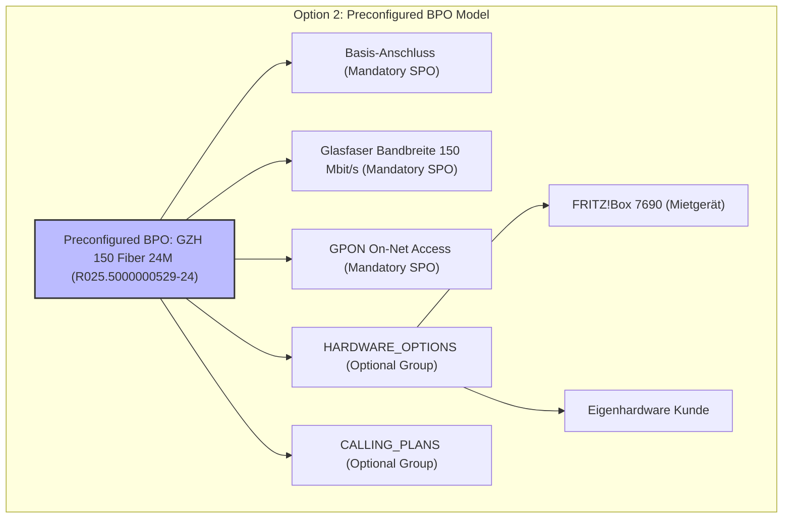
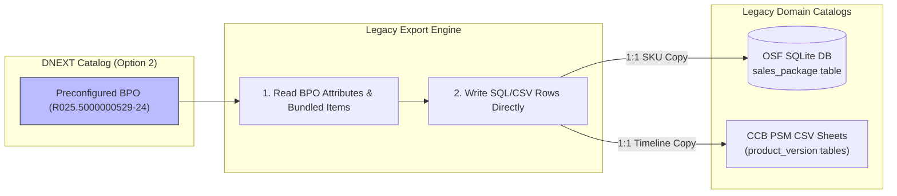

# Solution Architecture Proposal: Germany Product Catalog Redesign (Option 2)

This document defines **Option 2 (The Preconfigured BPO Pattern)** for the Vodafone Germany Fixed-Net Catalog transformation. Under this option, we model the catalog using TM Forum (TMF) 620 bundles, but create a **distinct, preconfigured Bundled Product Offering (BPO)** for each commercial Sales Package SKU (e.g. `R025.5000000529-24`). 

---

## 1. Executive Summary: Option 2 (Preconfigured BPO Pattern)

In **Option 2**, the catalog structures commercial tariffs as Bundled Product Offerings (`isBundle: true`), but pre-bundles specific, mandatory choices with strict cardinality limits. Instead of presenting a generic bundle where the user selects the speed and connection type at checkout, each commercial Sales Package SKU corresponds to a unique, pre-bound BPO in the catalog.



### Key Characteristics of Option 2:
1. **Pre-Bound Core Selections**: The specific speed tier (e.g. 150 Mbps) and voice connection type (e.g. Basic Connection) are bundled directly inside the BPO with a `bundledProductOfferingOption` setting `numberRelOfferLowerLimit = 1` and `numberRelOfferUpperLimit = 1` (mandatory).
2. **Metadata Mappings on BPO**: All legacy database attributes, billing codes (`InternetTariffCode = IP529`, `VoiceTariffCode = VP529`), and contract parameters are stored as static characteristic overrides (`prodSpecCharValueUse`) directly on the BPO itself.
3. **Dynamic Optional Add-ons**: Cross-sell items (CPE routers, TV boxes, and calling plan add-ons) are modeled as optional child offerings (either grouped or linked) to keep them reusable and decoupled.

---

## 2. Target TMF 620 Schema Mockup (Option 2)

Below is a mockup of the preconfigured commercial bundle `R025.5000000529-24` (`GigaZuhause 150 Glasfaser 24 Months`). Note how the speed and connection are pre-bound with strict `1..1` limits:

```json
{
  "id": "R025.5000000529-24",
  "name": "GigaZuhause 150 Glasfaser 24 Months",
  "version": "1.0",
  "lifecycleStatus": "Launched",
  "@type": "ProductOffering",
  "isBundle": true,
  "isSellable": true,
  "productSpecification": {
    "id": "VF_DE_SPEC_SALES_PACKAGE",
    "name": "VF_DE_Sales_Package_Specification",
    "@referredType": "ProductSpecification"
  },
  "category": [
    {
      "id": "FN0473",
      "name": "GigaZuhause Glasfaser",
      "@referredType": "Category"
    }
  ],
  "prodSpecCharValueUse": [
    {
      "name": "SKU",
      "valueType": "string",
      "configurable": false,
      "productSpecCharacteristicValue": [{ "value": "R025.5000000529-24", "isDefault": true }]
    },
    {
      "name": "ContractDuration",
      "valueType": "string",
      "configurable": false,
      "productSpecCharacteristicValue": [{ "value": "24", "isDefault": true }]
    },
    {
      "name": "Legacy_InternetTariffCode",
      "valueType": "string",
      "configurable": false,
      "productSpecCharacteristicValue": [{ "value": "IP529", "isDefault": true }]
    },
    {
      "name": "Legacy_VoiceTariffCode",
      "valueType": "string",
      "configurable": false,
      "productSpecCharacteristicValue": [{ "value": "VP529", "isDefault": true }]
    }
  ],
  "productOfferingPrice": [
    {
      "id": "pop-recurrent-R025.5000000529-24",
      "name": "GigaZuhause 150 Glasfaser 24 Months Monthly Fee",
      "priceType": "Recurring charge",
      "recurringChargePeriodType": "month",
      "price": {
        "value": 44.99,
        "unit": "EUR"
      }
    }
  ],
  "bundledProductOffering": [
    {
      "id": "speed_150_mbps_opt",
      "name": "Glasfaser Bandbreite 150 Mbit/s",
      "bundledProductOfferingOption": {
        "numberRelOfferLowerLimit": 1,
        "numberRelOfferUpperLimit": 1,
        "numberRelOfferDefault": 1
      }
    },
    {
      "id": "c_basic_spo",
      "name": "Basis-Anschluss",
      "bundledProductOfferingOption": {
        "numberRelOfferLowerLimit": 1,
        "numberRelOfferUpperLimit": 1,
        "numberRelOfferDefault": 1
      }
    }
  ],
  "bundledGroupProductOffering": [
    {
      "name": "HARDWARE_OPTIONS",
      "bundledGroupProductOfferingOption": {
        "numberRelOfferLowerLimit": 0,
        "numberRelOfferUpperLimit": 1
      },
      "bundledProductOffering": [
        {
          "id": "20090230_sub",
          "name": "FRITZ!Box 7690 (Mietgerät)",
          "bundledProductOfferingOption": {
            "numberRelOfferLowerLimit": 0,
            "numberRelOfferUpperLimit": 1,
            "numberRelOfferDefault": 0
          }
        },
        {
          "id": "20099900_sub",
          "name": "Eigenhardware Kunde",
          "bundledProductOfferingOption": {
            "numberRelOfferLowerLimit": 0,
            "numberRelOfferUpperLimit": 1,
            "numberRelOfferDefault": 1
          }
        }
      ]
    }
  ]
}
```

---

## 3. Exporter Architecture for Option 2 (Syncing to Legacy Domain Catalogs)

Under Option 2, the publishing and compilation pipeline (Legacy Export Engine) simplifies significantly because the catalog mappings are **declared explicitly** on each bundle rather than generated dynamically:



### 3.1. How Mappings are Resolved
1. **Relational Table Generation (`sales_package`)**:
   * The compiler reads the `SKU` characteristic from the BPO (`R025.5000000529-24`) and uses it as the primary key.
   * It maps BPO properties (like BPO Price `44.99 EUR` and BPO duration `24`) directly to target table fields (`maf` and `duration`) without summing child components.
2. **Component Mapping (`mapper_simple_products`)**:
   * Instead of traversing choices to identify active codes, the compiler extracts legacy keys directly from the BPO characteristics:
     * `Legacy_InternetTariffCode = IP529` ➔ Written as the Internet component code.
     * `Legacy_VoiceTariffCode = VP529` ➔ Written as the Voice component code.
3. **Child Option Exclusivity**:
   * Optional selection groups (like `HARDWARE_OPTIONS`) are parsed. Since routers remain standalone SPOs, they map 1:1 to the legacy `options` table, and the containment group properties translate to SQL rows in the `compatibility_rules` table.

---

## 4. Architectural Comparison: Option 1 vs. Option 2

| Architectural Dimension | Option 1: Dynamic Single Bundle | Option 2: Preconfigured BPOs | Solution Architect Assessment (Trade-off) |
| :--- | :--- | :--- | :--- |
| **Catalog Proliferation** | **Very Low**: Single bundle for all speed and duration variations. | **High**: Unique BPO file for every single commercial package SKU. | **Option 1** keeps the target catalog clean, whereas **Option 2** introduces files duplication (catalog bloat). |
| **Export Engine Complexity** | **High**: Must compute Cartesian products and sum prices dynamically. | **Low**: Performs simple direct mapping (1:1 copies of SKU rows). | **Option 2** is easier and faster to build for backward-compatibility exports. |
| **Storefront Integration** | **Agile**: Storefront dynamically resolves catalog selections and rules. | **Static**: Storefront retrieves locked packages with fixed properties. | **Option 1** is better for future BSS channels, while **Option 2** fits legacy storefront limitations. |
| **Maintenance Overhead** | **Low**: General attributes (like contract duration types) are updated once. | **Medium**: Updating a shared attribute requires modifying all bundle files. | **Option 1** reduces configuration maintenance; **Option 2** requires tooling to batch-update files. |
| **Billing Alignment** | **Decoupled**: Billing codes are compiled downstream during checkout. | **Coupled**: Legacy billing codes are stored directly on the commercial offer. | **Option 2** maintains a tighter coupling to legacy billing, easing synchronization. |

---

## 5. Architectural Recommendations for Option 2

If Vodafone Germany chooses **Option 2 (Preconfigured BPO Pattern)** to simplify integration with legacy catalog targets, we recommend implementing the following safeguards:

1. **Automate Bundle Cloning and Templating**:
   * Do not author the preconfigured BPOs manually. Build a **BPO Templating Tool** in the catalog authoring pipeline. 
   * When product managers define a new tariff speed or release (e.g. `R219`), the tool should automatically clone a base template (e.g. `GigaZuhause Glasfaser`) and generate the preconfigured BPO JSON payloads with the correct speed bounds and legacy mapping keys.
2. **Standardize Suffix Naming Conventions**:
   * Enforce strict naming rules on the BPO `id` fields to match the legacy SKU syntax (e.g., `[Release].[BasePackage]-[Duration]`). This allows downstream sync adapters to split and validate SKU strings without parsing nested JSON structures.
3. **Use Shared Child Offerings for Options**:
   * Keep voice calling plans (Euro-Flat, Int-Flat) and hardware routers (FRITZ!Boxes) as **shared, reusable Simple Product Offerings (SPOs)**. Avoid duplicating routers or flats inside the BPO files; link them as shared members of the BPO option groups.
